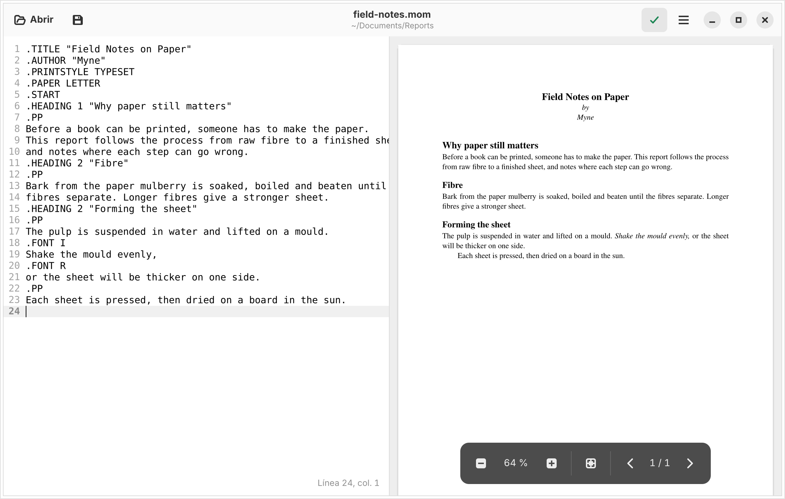

<div align="center">


# Myne

A desktop editor for groff documents written with the mom macros. Write on the
left, read the PDF on the right; every save compiles it.

[](LICENSE)
[](https://www.rust-lang.org)
[](https://www.gtk.org)



</div>

> [!NOTE]
> Early development: there are no releases or packages yet. Myne builds from
> source and has only been tested on Ubuntu 24.04. The interface is in Spanish.

---

## About

Writing with mom usually means an editor in one window, a terminal running
`pdfmom` in another and a PDF viewer in a third, reloading by hand. Myne puts
the three together, in the way TeXmaker does for LaTeX: an editor, a PDF
preview and a compilation log, with compilation on save.

It runs on Linux only, under Wayland or X11. groff itself comes from your
distribution; Myne does not bundle it.

### Built with

[](https://www.gtk.org)
[](https://gnome.pages.gitlab.gnome.org/libadwaita/)
[](https://gitlab.gnome.org/GNOME/gtksourceview)
[](https://poppler.freedesktop.org)
[](https://www.gnu.org/software/groff/)

---

## Features

- Compiles with `pdfmom` on every save, or on demand with `F5`, without ever
  blocking the window
- Keeps the previous PDF on screen when a compilation fails, with a banner
  saying so
- Keeps the page, the scroll position and the zoom when the PDF is reloaded
- Shows groff's messages as they arrive, one row each, marked as error or
  warning with the program, file and line that reported them; the log opens by
  itself when something fails
- Never runs two compilations at once: a new save cancels the one in progress
  and starts over with the latest text
- Renders only the pages near the viewport, at the zoom and screen scale in
  use, so long documents stay responsive and sharp on HiDPI screens
- Fits the page to the width by default, with `Ctrl` + wheel, buttons and
  shortcuts to zoom
- Lets you turn on the tbl, eqn, pic and refer preprocessors, change the
  command and stop compiling on save, from Preferences
- Asks before throwing away unsaved changes, on closing or opening another file
- Starts without groff installed, and says what is missing

---

## Installation

### From source

Install the build dependencies. Debian, Ubuntu:

```bash
sudo apt install libgtk-4-dev libadwaita-1-dev libgtksourceview-5-dev libpoppler-glib-dev blueprint-compiler groff
```

Then build and run:

```bash
git clone https://github.com/calmecac-dev/myne.git
cd myne
cargo run --release
```

Building needs Rust 1.92 or later, GTK 4.14, libadwaita 1.5, GtkSourceView 5.12
and Poppler 0.82. groff is only needed to compile documents, not to build.

There is no install target yet: the desktop file and the icon in `data/` are
not copied anywhere by the build.

---

## Usage

```bash
myne                  # an empty, untitled document
myne report.mom       # open a document
```

Opening a document also shows its PDF, if one was compiled before.

`Ctrl+S` saves and compiles. The PDF is written next to the source, with the
same name and a `.pdf` extension, and compilation runs from the source's
directory, so `.so`, images and other relative paths resolve as they would
from a terminal.

---

## Keyboard shortcuts

`Ctrl+?` lists them in the app.

| Shortcut | Action |
|---|---|
| `Ctrl+O` | Open a document |
| `Ctrl+S` | Save, and compile |
| `Ctrl+Shift+S` | Save as |
| `F5` | Compile the saved file without saving again |
| `Ctrl+Shift+L` | Show or hide the compilation log |
| `Ctrl++` / `Ctrl+-` | Zoom in / out |
| `Ctrl+0` | Fit the page to the width |
| `Ctrl` + wheel | Zoom |
| `Ctrl+,` | Preferences |
| `Ctrl+?` | Keyboard shortcuts |
| `Ctrl+Q` | Quit, asking first about unsaved changes |

---

## Details worth knowing

**Sources are read as UTF-8.** Myne always passes `-k` to `pdfmom`. Without
it, groff reads the file as Latin-1 and every accented letter comes out wrong in
the PDF. Files that are not valid UTF-8 are refused when opening, with the
reason.

**A failed compilation never touches the PDF.** `pdfmom` writes to a hidden
temporary file beside the source, which is renamed over the PDF only if the
compilation succeeded. The viewer never sees a half-written file.

**Errors count, not just the exit status.** groff exits with status 0 even
after reporting errors, so any message marked `error` or `fatal error`, and
any error from mom itself, counts as a failure. Warnings do not.

**Cancelling stops every process.** `pdfmom` starts groff, troff, preconv and
gropdf. Each compilation runs in its own process group, and cancelling it
stops the whole group, so a burst of saves leaves nothing running behind.

**The PDF is read into memory.** The viewer loads the file's bytes rather than
the path, so it neither depends on the file staying on disk nor keeps it open.

**Preferences live in a file.** They are kept in `~/.config/myne/config.toml`
and written from the Preferences window, which applies every change at once.

---

## Troubleshooting

**The banner says it cannot find `pdfmom`.** Install groff
(`sudo apt install groff`), or check the command in Preferences. Myne looks
for the program in `PATH` when it starts and whenever the command changes.

**A message in the log has no file or line.** groff did not give one. troff
omits the location, for instance, when a `.so` on the last line of a file
fails.

---

## How it works

Myne is one Rust process with a GTK 4 and libadwaita window. The interface is
described in Blueprint files under `data/ui/`, compiled at build time and
embedded in the binary as a GResource, together with the icons and the
stylesheet.

Compilation runs `pdfmom` as a child process through `gio::Subprocess` and
reads its stderr line by line on the main loop, with no threads of its own.
The PDF is drawn with Poppler on Cairo surfaces, one page at a time in idle
time, and only for the pages near the viewport.

---

## Project structure

```
myne/
├── data/
│   ├── icons/         The application icon and the save icon
│   ├── screenshots/   The screenshot in this README
│   ├── ui/            Blueprint files: the window, Preferences and the shortcuts
│   ├── dev.calmecac.Myne.desktop
│   ├── myne.gresource.xml
│   └── style.css
├── docs/              Development notes and the roadmap
├── src/
│   ├── application.rs Actions, shortcuts and the About dialog
│   ├── compiler.rs    Running pdfmom and parsing groff's messages
│   ├── config.rs      Preferences in TOML
│   ├── editor.rs      Helpers for the source editor
│   ├── log_panel.rs   The compilation log
│   ├── preferences.rs The Preferences window
│   ├── viewer.rs      The PDF viewer
│   ├── window.rs      The main window: files, compilation and status
│   └── main.rs
├── build.rs           Compiles the Blueprint files and the GResource
├── CHANGELOG.md
├── Cargo.toml
└── LICENSE
```

`compiler.rs` depends on glib and gio only, not on GTK, so its parser is tested
without a display.

---

## Roadmap

| Release | Focus |
|---------|-------|
| 0.1.0 | Editor, PDF preview and log, with compilation on save |
| 0.2.0 | Writing comfort: mom syntax highlighting, clickable errors, macro completion, recent files |
| 0.3.0 | Working from the PDF: selecting text, jumping from the PDF to the source, reloading on external changes |

See [`docs/roadmap.md`](docs/roadmap.md) for what each release holds.

---

## Documentation

| Resource | What it covers |
|----------|----------------|
| [CHANGELOG.md](CHANGELOG.md) | What changed in each release |
| [docs/roadmap.md](docs/roadmap.md) | What is done and what comes next |
| [docs/development.md](docs/development.md) | Building, testing, and the rules the code follows |

---

## Contributing

Issues and pull requests are welcome. For anything larger than a fix, open an
issue before writing code.

```bash
cargo test
cargo clippy --all-targets -- -D warnings
cargo fmt --check
```

---

## License

Distributed under the GPL-3.0-or-later license. See [LICENSE](LICENSE) for more
information.
